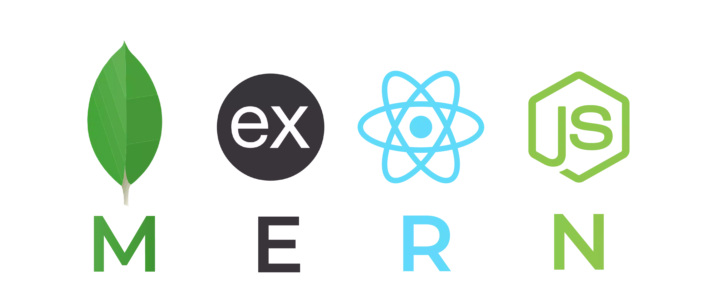

<div align="center">
  <br />
    <a href="https://3dfolio-ajfm88.vercel.app">
      
    </a>
  <br />

  <div>
    <a href="https://www.mongodb.com">
      
    </a>
    <a href="https://expressjs.com">
      
    </a>
    <a href="https://react.dev">
      
    </a>
    <a href="https://nodejs.org">
      
    </a>
    <a href="https://threejs.org">
      
    </a>
    <a href="https://vitejs.dev">
      
    </a>
    <a href="https://r3f.docs.pmnd.rs">
      
    </a>
    <a href="https://reactrouter.com">
      
    </a>
    <a href="https://drei.pmnd.rs">
      
    </a>
    <a href="https://tailwindcss.com">
      
    </a>
    <a href="https://firebase.google.com">
      
    </a>
    <a href="https://framer.com/motion">
      
    </a>
    <a href="https://socket.io">
      
    </a>
    <a href="https://clerk.com">
      
    </a>
    <a href="https://imagekit.io">
      
    </a>
  </div>

  <h3 align="center">3D Personal Portfolio Website</h3>
</div>

## 📋 <a name="table">Table of Contents</a>

1.  🤖 [Introduction](#introduction)
2.  🚀 [Live App](#live-app)
3.  🏗️ [Architecture](#architecture)
4.  ⚙️ [Tech Stack](#tech-stack)
5.  🔋 [Features](#features)
6.  🗂️ [Project Structure](#project-structure)
7.  🧭 [Pages and Routes](#pages-and-routes)
8.  🤸 [Quick Start](#quick-start)

## 🤖 <a name="introduction">Introduction</a>

This is the personal website of Alejandro J. Foucault (ajfm88). The home page is a 3D portfolio built with React, and four more tools live on the same domain:

- a **GitHub Follower Tracker** at `/gft`
- a **blog** at `/blog`
- a **real-time chat** at `/chat`
- a **collaborative system-design workspace** at `/collaborate`

In the workspace, signed-in users create projects, invite other people, and draw system diagrams together on a shared canvas. One person edits at a time while everyone else watches the changes live, and each project has its own chat.

## 🚀 <a name="live-app">Live App</a>

<a href="https://3dfolio-ajfm88.vercel.app"></a>
<a href="https://ajfm88-3dfolio-api.onrender.com"></a>

## 🏗️ <a name="architecture">Architecture</a>

The site runs on two backends. Each one serves the part of the app it suits best.

| Layer                         | Backend                                      | Powers                                        | Hosting |
| ----------------------------- | -------------------------------------------- | --------------------------------------------- | ------- |
| This root project             | Firebase (Firestore, Storage, Auth)          | The 3D portfolio, `/gft`, and the admin panel | Vercel  |
| [`server/`](server/readme.md) | Express, MongoDB, Clerk, Socket.io, ImageKit | `/blog`, `/chat`, and `/collaborate`          | Render  |

Firebase holds the content that only the site owner edits. It is read over plain REST calls, so there is no server to run or keep awake.

The blog and the chat need more than that: users, posts, comments and messages that reference each other, and a WebSocket server for presence and message delivery. The workspace adds project rooms, live presence, turn-taking, and canvas saves that the server validates. All three therefore use a separate API, which lives in [`server/`](server/readme.md). They share one sign-in system, one database and one deployment.

Every feature route is lazy-loaded, so Clerk, Axios, Zustand, socket.io-client and React Flow never reach the main portfolio bundle. The API endpoints, database schema and socket events are documented in [`server/readme.md`](server/readme.md).

## ⚙️ <a name="tech-stack">Tech Stack</a>

<div align="center">
  
</div>

**Frontend core (this repo, `src/`):**

- ⚛️ [React](https://react.dev)
- ⚡ [Vite](https://vitejs.dev)
- 🧭 [React Router](https://reactrouter.com)
- 🌬️ [Tailwind CSS](https://tailwindcss.com)

**Frontend 3D and motion:**

- 🔺 [Three.js](https://threejs.org)
- 🧵 [React Three Fiber](https://r3f.docs.pmnd.rs)
- 🔧 [React Three Drei](https://drei.pmnd.rs)
- 🎞️ [Framer Motion](https://framer.com/motion)

**Frontend data, auth and content:**

- 🔥 [Firebase](https://firebase.google.com)
- 🔐 [Clerk](https://clerk.com)
- 🔄 [TanStack Query](https://tanstack.com/query)
- 📡 [Axios](https://axios-http.com)
- 🐻 [Zustand](https://zustand.docs.pmnd.rs)
- 📐 [React Flow](https://reactflow.dev) (`@xyflow/react`)
- 🔌 [Socket.io Client](https://socket.io)
- ✍️ [React Quill](https://github.com/VaguelySerious/react-quill)
- 🖼️ [ImageKit](https://imagekit.io)
- 🔔 [React Toastify](https://fkhadra.github.io/react-toastify)
- 🕒 [timeago.js](https://timeago.ling.pub)

**Backend ([`server/`](server/readme.md), deployed separately on Render):**

- 🟢 [Node.js](https://nodejs.org)
- 🚂 [Express](https://expressjs.com)
- 🍃 [MongoDB Atlas](https://www.mongodb.com/atlas)
- 🧬 [Mongoose](https://mongoosejs.com)
- 🔐 [Clerk](https://clerk.com)
- 🔌 [Socket.io](https://socket.io)
- 🖼️ [ImageKit](https://imagekit.io)
- 📤 [Multer](https://github.com/expressjs/multer)

The backend has its own readme with the full API, the schema and the reasons behind the design: **[`server/readme.md`](server/readme.md)**.

## 🔋 <a name="features">Features</a>

🎨 **Animated Experience and Work Sections:** The experience timeline and the project cards animate into view with Framer Motion.

💡 **3D Skills Section:** The tech stack is shown as 3D objects built with Three.js and React Three Fiber.

🎬 **Animated Projects:** Each project card fades in as you scroll to it.

🌍 **Contact Section with 3D Earth Model:** A 3D earth you can rotate sits next to a contact form that sends email.

✨ **3D Stars:** A Three.js starfield fills the background, with stars placed at random positions.

🎞️ **Consistent Animations:** One shared set of Framer Motion variants keeps the motion consistent across the site.

📱 **Responsive Design:** The site works on phones, tablets and desktops.

🖌️ **Tailwind CSS Styling:** All styling is done with Tailwind CSS.

🔥 **Firebase-Powered Admin Panel:** The site owner edits the portfolio content from a private dashboard, signed in with Google and backed by Firestore and Firebase Storage.

🔎 **GitHub Follower Tracker (`/gft`):** Compares snapshots of any account's followers over time to show who followed and who unfollowed. It runs entirely in the browser.

✍️ **Blog Authoring (`/blog`):** The owner writes rich-text posts, with cover images uploaded straight from the browser to ImageKit.

🗂️ **Blog Browsing:** Readers filter posts by category, author and search, and sort them by newest, oldest, Popular or Trending (both based on visits). Every filter lives in the URL, so a view can be shared.

💬 **Blog Comments:** Any signed-in reader can comment on a post. Writing posts stays restricted to the owner, and the API enforces it.

⚡ **Real-Time Chat (`/chat`):** Signed-in users message each other instantly over Socket.io, with no polling.

🖼️ **Chat Media:** Messages can carry an image or a video with an optional caption. Images open in a lightbox and videos play in the native player.

🟢 **Chat Presence and Sounds:** The chat shows who is online, marks unread conversations with a badge, and plays a sound for new messages that can be switched off.

📐 **Collaborative Workspace (`/collaborate`):** Signed-in users create projects and draw system diagrams together on a shared React Flow canvas, with six shapes, labelled connections and an eight-color palette.

🔁 **Turn-Based Editing:** One browser tab edits at a time while everyone else watches live. The server enforces the turn: there is a queue, a 20-second grace period for reconnecting, and a hand-off after 2 minutes without activity when someone is waiting.

👥 **Live Presence:** Participant avatars, live cursors, and live drag and resize previews show who is present and what the turn holder is changing.

💬 **Project Chat:** Each project has a chat thread with history, image and video attachments, typing indicators and an unread badge.

🤝 **Sharing and Roles:** Owners invite by email as editor or viewer, change roles and remove members, and every change applies live.

↩️ **Undo and Redo:** The turn holder can undo and redo their own edits, and watchers see the same result.

🧱 **Starter Templates:** The turn holder can drop one of twenty-seven ready-made diagrams onto the canvas, grouped by theme, from architecture patterns to system design classics such as a URL shortener, a chat system, a payment system and a web crawler.

🧩 **Lazy Feature Routes:** The admin panel, blog, chat and workspace load as separate bundles, so none of them slows down the 3D portfolio.

## 🗂️ <a name="project-structure">Project Structure</a>

```
3dfolio/
├── public/                                 # Served as-is, filenames stable across builds
│   ├── models/                             # Draco-compressed .glb models for the rotating cube
│   ├── planet/                             # glTF earth model used by the contact section
│   ├── sounds/                             # Chat keystroke and notification audio
│   ├── ajfm88-alejandro-foucault.png       # Wordmark used by the portfolio and chat navbars
│   ├── ajfm88-alejandro-foucault-blog.png  # Dark-on-light wordmark for the blog navbar
│   ├── favicon.png
│   ├── hero-bg.svg
│   ├── og-image.png                        # 1200x630 link-preview card
│   ├── robots.txt
│   ├── sitemap.xml
│   └── skills-bg.webm
├── server/                                 # Express + MongoDB + Socket.io API, see server/readme.md
├── src/
│   ├── admin/
│   │   ├── AdminLogin.jsx                  # Google sign-in screen for the panel
│   │   ├── AdminShell.jsx                  # Panel frame and navigation between managers
│   │   ├── useAuth.js                      # Firebase auth state and owner-account check
│   │   ├── AboutManager.jsx                # Editor for the About section
│   │   ├── aboutApi.js                     # Firestore reads and writes for About
│   │   ├── ExperienceManager.jsx           # List view for timeline entries
│   │   ├── ExperienceForm.jsx              # Create and edit form for one entry
│   │   ├── experiencesApi.js               # Firestore reads and writes for Experience
│   │   ├── HeroManager.jsx                 # Editor for the hero tagline
│   │   ├── heroApi.js                      # Firestore reads and writes for Hero
│   │   ├── ProjectManager.jsx              # List view for projects
│   │   ├── ProjectForm.jsx                 # Create and edit form for one project
│   │   ├── projectsApi.js                  # Firestore reads and writes for Projects
│   │   ├── TechManager.jsx                 # Editor for the six rotating cube faces
│   │   └── techApi.js                      # Firestore reads and writes for Tech
│   ├── assets/
│   │   ├── tech/                           # Technology logos for the cube fallback data
│   │   ├── close.svg                       # Mobile menu close icon
│   │   ├── github.png                      # Source link icon on project cards
│   │   ├── index.js                        # Asset barrel export
│   │   └── menu.svg                        # Mobile menu open icon
│   ├── blog/
│   │   ├── components/
│   │   │   ├── BlogNavbar.jsx              # Blog header with search and auth controls
│   │   │   ├── Comment.jsx                 # A single comment row
│   │   │   ├── Comments.jsx                # Comment list and composer
│   │   │   ├── FeaturedPosts.jsx           # Featured section on the blog homepage
│   │   │   ├── Image.jsx                   # ImageKit-backed responsive image
│   │   │   ├── MainCategories.jsx          # Category bar with inline search
│   │   │   ├── PostList.jsx                # Infinite-scrolling post list
│   │   │   ├── PostListItem.jsx            # A single post card
│   │   │   ├── PostMenuActions.jsx         # Feature and delete actions for the owner
│   │   │   ├── Search.jsx                  # Search input writing to the query string
│   │   │   ├── SideMenu.jsx                # Filter and sort sidebar
│   │   │   └── Upload.jsx                  # Direct browser-to-ImageKit upload wrapper
│   │   ├── layouts/
│   │   │   └── BlogLayout.jsx              # Light-theme page frame and blog-root scope
│   │   ├── lib/
│   │   │   ├── axios.js                    # Blog axios instance with optional bearer token
│   │   │   ├── useBlogUsername.js          # Resolves the display handle for an author
│   │   │   └── useIsAdmin.js               # Reads the owner role off the Clerk session
│   │   ├── routes/
│   │   │   ├── Homepage.jsx                # Blog landing page
│   │   │   ├── PostListPage.jsx            # Full post list with filters
│   │   │   ├── SinglePostPage.jsx          # One post, its author, and its comments
│   │   │   └── Write.jsx                   # Rich-text editor, owner only
│   │   └── blog.css                        # Styles for editor chrome and rendered post HTML
│   ├── chat/
│   │   ├── components/
│   │   │   ├── AvatarWithOnlineIndicator.jsx  # Avatar with a presence dot
│   │   │   ├── ChatComposer.jsx            # Message input, media picker, typing relay
│   │   │   ├── ChatHeader.jsx              # Active conversation header
│   │   │   ├── ChatSidebar.jsx             # Conversation and contact list
│   │   │   ├── ConversationRow.jsx         # A single sidebar row with unread badge
│   │   │   ├── MessageBubble.jsx           # One message, with media and caption
│   │   │   └── MessageList.jsx             # Scrolling thread with typing indicator
│   │   ├── hooks/
│   │   │   ├── useKeyboardSound.js         # Keystroke click playback
│   │   │   ├── useMediaQuery.js            # Breakpoint matching for the mobile layout
│   │   │   ├── useScrollToBottom.js        # Keeps the thread pinned to the newest message
│   │   │   └── useVisualViewportHeight.js  # Tracks the on-screen keyboard on mobile
│   │   ├── lib/
│   │   │   ├── axios.js                    # Chat axios instance with bearer token
│   │   │   ├── notificationSound.js        # Incoming-message chime
│   │   │   └── utils.js                    # Timestamp and grouping helpers
│   │   ├── routes/
│   │   │   ├── ChatAuthGate.jsx            # Sign-in screen for signed-out visitors
│   │   │   └── ChatPage.jsx                # Sidebar plus thread layout
│   │   ├── store/
│   │   │   ├── useAuthStore.js             # Auth check, socket connection, presence
│   │   │   └── useChatStore.js             # Conversations, messages, unread state
│   │   └── chat.css                        # Chat-scoped styles
│   ├── collaborate/                        # Turn-based system-design workspace
│   │   ├── components/                     # Workspace UI
│   │   │   ├── canvas/                     # Shapes, edges, controls, and live cursors
│   │   │   ├── chat/                       # Project thread and composer
│   │   │   ├── projects/                   # Project cards, dialogs, and invitations
│   │   │   ├── ui/                         # Shared dialog shell and role badge
│   │   │   └── workspace/                  # Navbar, participants, turns, sharing, connection state
│   │   ├── hooks/                          # Chat scrolling and visual viewport height
│   │   ├── lib/                            # Canvas sync, history, presence, and UI helpers
│   │   ├── routes/                         # Sign-in gate, dashboard, and workspace
│   │   ├── store/                          # Session, project, canvas, chat, and membership state
│   │   └── collaborate.css                 # Scoped dark theme and canvas styles
│   ├── components/
│   │   ├── canvas/
│   │   │   ├── Earth.jsx                   # Rotatable earth in the contact section
│   │   │   ├── Particles.jsx               # Particle background
│   │   │   ├── Stars.jsx                   # Procedural starfield
│   │   │   └── TechIconCard.jsx            # 3D model card for one technology
│   │   ├── About.jsx                       # About section, content from Firestore
│   │   ├── AnimatedLetters.jsx             # Per-letter hover animation
│   │   ├── Contact.jsx                     # Contact form and social links
│   │   ├── ErrorBoundary.jsx               # Catches a failed lazy route
│   │   ├── Experience.jsx                  # Vertical timeline, content from Firestore
│   │   ├── Hero.jsx                        # Landing hero and tagline
│   │   ├── Loader.jsx                      # Canvas loading indicator
│   │   ├── Navbar.jsx                      # Portfolio navigation
│   │   ├── RotatingCube.jsx                # Six-faced tech cube, content from Firestore
│   │   ├── RotatingCube.css                # Cube face geometry and spin keyframes
│   │   ├── TakeOnMeDot.jsx                 # Hero dot hiding the Take On Me easter egg
│   │   ├── Tech.jsx                        # Tech stack section
│   │   ├── Works.jsx                       # Project cards, content from Firestore
│   │   └── index.js                        # Component barrel export
│   ├── constants/
│   │   ├── about.js                        # Seed and fallback copy for About
│   │   ├── brand.js                        # Wordmark paths and shared alt text
│   │   ├── hero.js                         # Seed and fallback copy for the hero
│   │   ├── index.js                        # Navigation links and timeline icons
│   │   └── tech.js                         # Seed and fallback data for the cube
│   ├── easterEgg/
│   │   └── takeOnMe.ditty.js               # Tonny Espeset's Dittytoy score, credit kept
│   ├── hoc/
│   │   ├── SectionWrapper.jsx              # Shared section padding and scroll anchor
│   │   └── index.js                        # HOC barrel export
│   ├── pages/
│   │   ├── Admin.jsx                       # Admin panel route root, private
│   │   ├── Blog.jsx                        # Blog route root, providers and nested routes
│   │   ├── Chat.jsx                        # Chat route root, providers and bootstrap
│   │   ├── Collaborate.jsx                 # Workspace route root, providers and lazy routes
│   │   └── GithubFollowerTracker.jsx       # Follower comparison tool
│   ├── utils/
│   │   ├── firestoreRest.js                # Firestore REST reads for public content
│   │   ├── motion.js                       # Shared Framer Motion variants
│   │   └── richText.jsx                    # Renders stored rich text safely
│   ├── App.jsx                             # Router, lazy routes, error boundaries
│   ├── firebase.js                         # Firebase app initialization
│   ├── index.css                           # Global styles and Tailwind directives
│   ├── main.jsx                            # React entry point
│   └── styles.js                           # Shared Tailwind class groups
├── test/                                   # Client store and markup suites, run one per command
├── context/                                # Spec-driven build documents
├── .env.example
├── index.html                              # SEO, Open Graph, and Twitter card tags
├── mern.png
├── package.json
├── postcss.config.cjs
├── readme.md
├── tailwind.config.cjs
├── vercel.json                             # SPA rewrite so deep links resolve
└── vite.config.js
```

## 🧭 <a name="pages-and-routes">Pages and Routes</a>

| Route                     | Page                    | Bundle | Access          |
| ------------------------- | ----------------------- | ------ | --------------- |
| `/`                       | 3D portfolio            | Main   | Public          |
| `/gft`                    | GitHub Follower Tracker | Lazy   | Public          |
| `/blog`                   | Blog homepage           | Lazy   | Public          |
| `/blog/posts`             | Full post list          | Lazy   | Public          |
| `/blog/:slug`             | Single post             | Lazy   | Public          |
| `/blog/write`             | Rich-text editor        | Lazy   | Owner           |
| `/chat`                   | Real-time chat          | Lazy   | Signed in       |
| `/collaborate`            | Projects dashboard      | Lazy   | Signed in       |
| `/collaborate/:projectId` | Workspace               | Lazy   | Project members |

Only `/` ships in the main bundle. Every other route is code-split, so a visitor who never opens the blog, the chat or the workspace never downloads Clerk, Axios, Zustand, socket.io-client or React Flow.

Who can see what:

- `/blog` is open to everyone, and any signed-in reader can comment. Only the owner account can write posts, and the API enforces that; it is not just a hidden button.
- `/chat` shows a sign-in screen to visitors who are signed out.
- `/collaborate` also shows a sign-in screen to visitors who are signed out. A project is visible only to its owner and the people invited to it, and a viewer can watch and chat but cannot edit.

## 🤸 <a name="quick-start">Quick Start</a>

Follow these steps to set up the project locally on your machine.

**Prerequisites**

Make sure you have the following installed on your machine:

- 🌳 [Git](https://git-scm.com)
- 🟢 [Node.js](https://nodejs.org)
- 📦 [npm](https://npmjs.com)

**Cloning the Repository**

```bash
git clone https://github.com/ajfm88/3dfolio.git
cd 3dfolio
```

**Installation**

Install the project dependencies using npm:

```bash
npm install
```

**Set Up Environment Variables**

Create a `.env` file in the project root (copy `.env.example`) and fill in the values:

```env
VITE_FIREBASE_API_KEY=
VITE_FIREBASE_AUTH_DOMAIN=
VITE_FIREBASE_PROJECT_ID=
VITE_FIREBASE_STORAGE_BUCKET=
VITE_FIREBASE_MESSAGING_SENDER_ID=
VITE_FIREBASE_APP_ID=

VITE_CLERK_PUBLISHABLE_KEY=
VITE_API_URL=

VITE_IK_URL_ENDPOINT=
VITE_IK_PUBLIC_KEY=

VITE_APP_GETFORM_DOT_IO_ENDPOINT=
```

Where each one comes from:

- **`VITE_FIREBASE_*`**: Firebase console, under **Project settings → Your apps → Web app**. Backs the admin panel and the content it serves.
- **`VITE_CLERK_PUBLISHABLE_KEY`**: Clerk dashboard, under **Developers → API keys**. Signs users in to `/blog`, `/chat` and `/collaborate`.
- **`VITE_API_URL`**: base URL of the [`server/`](server/readme.md) API, including its `/api` prefix. It can point at a local instance or a deployed one.
- **`VITE_IK_*`**: ImageKit dashboard, under **Developers → API keys**, plus the URL endpoint. These let the browser upload blog cover images directly. They are the public half of the same account `server/` uses; the ImageKit **private** key stays on the backend and never appears here.
- **`VITE_APP_GETFORM_DOT_IO_ENDPOINT`**: [Getform](https://getform.io) endpoint that receives the portfolio's contact form submissions.

**Running the Project**

```bash
npm run dev
```

This starts the frontend only. The 3D portfolio, `/gft` and the admin panel work on their own. `/blog`, `/chat` and `/collaborate` also need the [`server/`](server/readme.md) API to be reachable at `VITE_API_URL`. Either run it locally (`cd server && npm install && npm run dev`; its readme covers the setup) or point at a deployed instance.

Open [http://localhost:5173](http://localhost:5173) in your browser to view the project.

**drawDB**

`drawdb/` is a separate app with its own dependencies. It is served at `/drawdb/` and is currently a placeholder that reads `drawDB is being set up.` No navbar link is added in this step. Any future link from the portfolio must be a plain `<a href="/drawdb/">`, which loads that document with a full page navigation.

`npm run dev:drawdb` starts the drawDB development server. It does not install packages. If `drawdb/node_modules` is missing, install them first with `npm --prefix drawdb install`. The development base is `/drawdb/`.

`npm run build` builds the portfolio, then installs the drawDB dependencies, including dev dependencies, and builds drawDB into `dist/drawdb/`. `npm run build:drawdb` builds only that app.

Deploy this repository from its root. The Vercel build command stays `npm run build` (do not override it to `vite build`) and the output directory stays `dist`. Node must satisfy the engines of the installed Vite packages. Vite 7.3.5 and Vite 8.3.5 both require `^20.19.0 || >=22.12.0`. A version whose number is only higher than 20.19 is not automatically compatible. Root `npm run preview` does not apply `vercel.json`, so it does not prove that a `/drawdb/...` reload stays on the drawDB document.

**Running the Tests**

The server tests run with one command:

```bash
cd server && npm test
```

The client tests for `/collaborate` live in `test/` at the root. Run one suite per command, because the suites share a port:

```bash
node --test test/canvasTemplates.test.mjs
```
